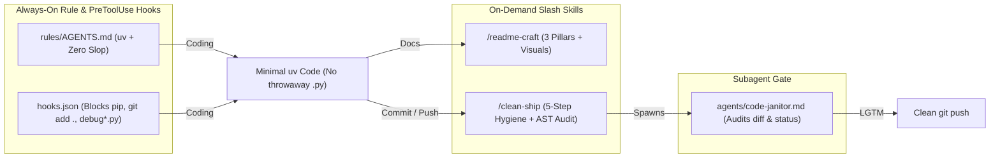

# agy-clean-craft

Portable Google Antigravity plugin, rules, lifecycle hooks, and skills that enforce `uv`-first Python, block throwaway `.py` scripts and AI code slop, and standardize visual 3-pillar READMEs and pre-push reviews across all your machines.

## Workflow & Architecture



## Quickstart & 1-Line Installation

### Option 1: Native Antigravity Plugin (Recommended)
Install the full bundle (`plugin.json`, `hooks.json`, `rules/AGENTS.md`, `agents/code-janitor.md`, `/clean-ship`, and `/readme-craft`) in one command:

```bash
agy plugin install https://github.com/Waxguillermo/agy-clean-craft
```

Or clone directly into your global Antigravity plugins directory:

```bash
git clone https://github.com/Waxguillermo/agy-clean-craft.git ~/.gemini/config/plugins/agy-clean-craft
```

### Option 2: Zero-Clone Global Sync via `uvx` (or `skills.sh`)
Merge the rules non-destructively into `~/.gemini/config/AGENTS.md` (preserving any existing custom rules) and install all skills:

```bash
# Via uvx (no manual clone required)
uvx --from git+https://github.com/Waxguillermo/agy-clean-craft agy-sync install

# Or via skills.sh CLI
npx skills add Waxguillermo/agy-clean-craft
```

## Usage Example

Audit any local repository for throwaway scripts, silent `except Exception: pass` AST slop, and README 3-pillar compliance, or check your global installation status:

```bash
$ uv run agy-sync audit
[LGTM] /path/to/repo: zero throwaway scripts, AST slop, or README issues.

$ uv run agy-sync status
[OK] /home/user/.gemini/config/rules/AGENTS.md
[OK] /home/user/.gemini/config/skills/clean-ship/SKILL.md
[OK] /home/user/.gemini/config/skills/readme-craft/SKILL.md
```

Inside Antigravity, skills activate automatically based on your task or can be triggered explicitly via slash commands:
- `/readme-craft` — Draft or upgrade `README.md` with Mermaid diagrams and `uv` quickstarts.
- `/clean-ship` — Run the 5-step pre-commit sweep, AST/README audit, `ruff` + `pytest`, and `code-janitor` review.

## Newcomer Map

| Path | Purpose |
| :--- | :--- |
| `plugin.json` | Antigravity plugin manifest (`displayName`, `logo`, `suggestedPrompts`) |
| `hooks.json` | Deterministic `PreToolUse` hooks blocking throwaway `.py` scripts, bare `pip`, and `git add .` |
| `rules/AGENTS.md` | Always-on rules: `uv` enforcement, no throwaway `.py` scripts, anti-slop guardrails |
| `agents/code-janitor.md` | Native subagent definition for independent pre-commit diff and README auditing |
| `skills/readme-craft/SKILL.md` | Enforces Understandability (Mermaid/dataviz/screenshots), Easy Deployment (`uv`), and Newcomer Utility |
| `skills/clean-ship/SKILL.md` | 5-step pre-push checklist: black-box audit, `ruff` + `pytest`, README check, `code-janitor` review |
| `src/agy_clean_craft/audit.py` | Zero-dependency AST, workspace throwaway file, and 3-pillar README linter |
| `src/agy_clean_craft/hooks.py` | `PreToolUse` hook evaluator for `write_file` and `run_command` |
| `src/agy_clean_craft/cli.py` | Non-destructive `agy-sync` CLI (`install`, `status`, `uninstall`, and `audit` commands) |

## Development

```bash
uv run pytest
uvx ruff check . && uvx ruff format --check .
uv run agy-sync audit
```

## License

[MIT](LICENSE) © Waxguillermo
