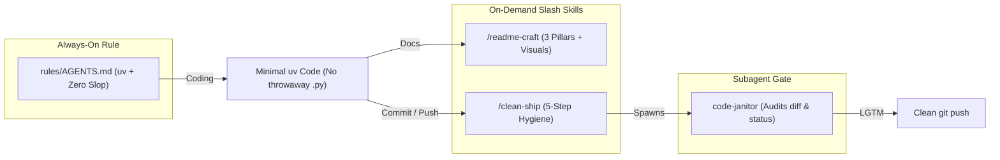

# agy-clean-craft

Portable Google Antigravity plugin, rules, and skills that enforce `uv`-first Python, eliminate throwaway `.py` scripts and AI code slop, and standardize visual 3-pillar READMEs and pre-push reviews across all your machines.

## Workflow & Architecture



## Quickstart & 1-Line Installation

### Option 1: Native Antigravity Plugin (Recommended)
Install the full bundle (`plugin.json`, `rules/AGENTS.md`, `/clean-ship`, and `/readme-craft`) in one command:

```bash
agy plugin install https://github.com/Waxguillermo/agy-clean-craft
```

Or clone directly into your global Antigravity plugins directory:

```bash
git clone https://github.com/Waxguillermo/agy-clean-craft.git ~/.gemini/config/plugins/agy-clean-craft
```

### Option 2: Zero-Clone Global Sync via `uvx` (or `skills.sh`)
Merge the rules non-destructively into `~/.gemini/config/AGENTS.md` (preserving any existing custom rules) and install all skills:

```bash
# Via uvx (no manual clone required)
uvx --from git+https://github.com/Waxguillermo/agy-clean-craft agy-sync install

# Or via skills.sh CLI
npx skills add Waxguillermo/agy-clean-craft
```

## Usage Example

Verify, update, or cleanly uninstall global rules and skills at any time:

```bash
$ uv run agy-sync status
[OK] /home/user/.gemini/config/rules/AGENTS.md
[OK] /home/user/.gemini/config/skills/clean-ship/SKILL.md
[OK] /home/user/.gemini/config/skills/readme-craft/SKILL.md

# Remove agy-clean-craft while keeping your other custom AGENTS.md rules intact
$ uv run agy-sync uninstall
Removed 3 agy-clean-craft entries from /home/user/.gemini/config.
```

Inside Antigravity, skills activate automatically based on your task or can be triggered explicitly via slash commands:
- `/readme-craft` — Draft or upgrade `README.md` with Mermaid diagrams and `uv` quickstarts.
- `/clean-ship` — Run the 5-step pre-commit sweep, `ruff` + `pytest`, and `code-janitor` review.

## Newcomer Map

| Path | Purpose |
| :--- | :--- |
| `plugin.json` | Antigravity plugin manifest (`displayName`, `logo`, `suggestedPrompts`) |
| `assets/logo.svg` | Plugin vector icon for the Antigravity Customizations UI |
| `rules/AGENTS.md` | Always-on rules: `uv` enforcement, no throwaway `.py` scripts, anti-slop guardrails |
| `skills/readme-craft/SKILL.md` | Enforces Understandability (Mermaid/dataviz/screenshots), Easy Deployment (`uv`), and Newcomer Utility |
| `skills/clean-ship/SKILL.md` | 5-step pre-push checklist: workspace sweep, `ruff` + `pytest`, README check, `code-janitor` subagent audit |
| `src/agy_clean_craft/cli.py` | Non-destructive `agy-sync` CLI (`install`, `status`, and `uninstall` commands) |

## Development

```bash
uv run pytest
uvx ruff check . && uvx ruff format --check .
```
