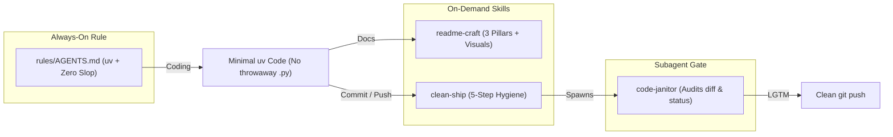

# agy-clean-craft

Portable Google Antigravity rules and skills that enforce `uv`-first Python, eliminate throwaway `.py` scripts and AI code slop, and standardize visual 3-pillar READMEs and pre-push reviews across all your machines.

## Workflow & Architecture



## Quickstart & Multi-Machine Deployment (`uv`)

Run this on any computer to install the global rules and skills into `~/.gemini/config`:

```bash
git clone https://github.com/Waxguillermo/agy-clean-craft.git
cd agy-clean-craft

# Install dependencies and sync rules + skills globally
uv sync
uv run agy-sync install
```

Alternatively, install directly as a global Antigravity plugin:

```bash
git clone https://github.com/Waxguillermo/agy-clean-craft.git ~/.gemini/config/plugins/agy-clean-craft
```

## Usage Example

Verify that your machine has all rules and skills active:

```bash
$ uv run agy-sync status
[OK] /home/user/.gemini/config/rules/AGENTS.md
[OK] /home/user/.gemini/config/skills/clean-ship/SKILL.md
[OK] /home/user/.gemini/config/skills/readme-craft/SKILL.md
```

## Newcomer Map

| Path | Purpose |
| :--- | :--- |
| `rules/AGENTS.md` | Always-on rules: `uv` enforcement, no throwaway `.py` scripts, anti-slop guardrails |
| `skills/readme-craft/SKILL.md` | Enforces Understandability (Mermaid/dataviz/screenshots), Easy Deployment (`uv`), and Newcomer Utility |
| `skills/clean-ship/SKILL.md` | 5-step pre-push checklist: workspace sweep, `ruff` + `pytest`, README check, `code-janitor` subagent audit |
| `src/agy_clean_craft/cli.py` | `agy-sync` CLI (`install` and `status` commands) |
| `plugin.json` | Antigravity plugin manifest |

## Development

```bash
uv run pytest
uvx ruff check . && uvx ruff format --check .
```
