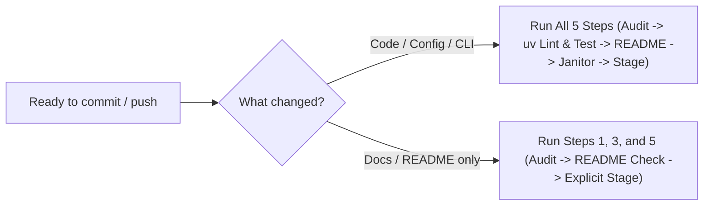

# Clean & Ship Workflow (`/clean-ship`)

Follow this protocol before committing or pushing changes so the repository stays reproducible, minimal, and free of AI code slop.

## Decision Tree: Which Steps to Run



---

## Step 1: Black-Box Workspace & AST Audit
1. Run the bundled audit script as a black box (do not read its source code) alongside `git status --short`:
   ```bash
   python3 skills/clean-ship/scripts/audit.py --repo .
   ```
   *(Or `uv run agy-sync audit` if installed in the environment.)*
2. Delete any flagged ad-hoc scripts (`debug*.py`, `tmp*.py`, `test_quick*.py`, `verify*.py`, `check_*.py`, `dump_*.py`, `scratch*.py`), fix any silent `except Exception: pass` blocks, and verify `.gitignore` covers `.venv/`, `__pycache__/`, `.ruff_cache/`, `.pytest_cache/`, and `.env`.

## Step 2: Format, Lint & Test with `uv`
1. Format and lint Python files:
   ```bash
   uvx ruff check --fix . && uvx ruff format .
   ```
2. If tests exist, run them via `uv`:
   ```bash
   uv run pytest
   ```
3. Fix any failing tests or lint issues before continuing.

## Step 3: README & Visual Check
1. If entrypoints, architecture, CLI flags, or deployment steps changed, activate the **`readme-craft`** skill and update `README.md`.
2. Re-run `python3 skills/clean-ship/scripts/audit.py --repo .` to confirm that every file path listed in the `Newcomer Map` table exists on disk and that all Mermaid labels with parentheses are wrapped in double quotes.

## Step 4: Independent Subagent Audit (`code-janitor`)
For any non-trivial code change, invoke the bundled **`code-janitor`** subagent (defined in [`agents/code-janitor.md`](../../agents/code-janitor.md)) using `invoke_subagent` (or `define_subagent` if running standalone):
- **Name**: `code-janitor`
- **Task**: Inspect `git status` and `git diff`, run the audit check, and return a short bulleted list of required fixes or `LGTM`.
- Fix every issue reported by `code-janitor` before committing.

## Step 5: Explicit Stage, Commit & Push
1. Stage only intentional files explicitly (this prevents accidentally committing untracked secrets or scratch artifacts):
   ```bash
   git add <file1> <file2>
   ```
   *(Never run `git add .` or `git add -A` blindly.)*
2. Verify staged changes with `git diff --staged --stat`.
3. Commit using a concise Conventional Commit message (`type(scope): summary`):
   - **Good**: `feat(cli): preserve existing user rules in AGENTS.md during sync`
   - **Bad**: `update files and fix bugs`
