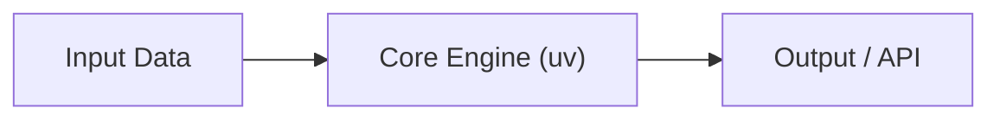

# README Craft Skill (`/readme-craft`)

Every `README.md` must optimize for **three goals**:
1. **Understandability** — A reader grasps what the project does and how its pieces fit together in under 30 seconds.
2. **Easy Deployment** — Anyone can install, configure, and run/deploy the project on the first try using `uv`.
3. **Utility for Newcomers** — A new developer immediately knows where the entrypoints are, how to run a real example, and how to test/modify it.

---

## Visual Selection Decision Tree

Choose the right visual based on what the project actually does (skip visuals only for trivial single-file scripts):

| Project Type | Recommended Visual |
| :--- | :--- |
| **CLI / Library / Service / Pipeline** | `mermaid` diagram (`flowchart LR`, `flowchart TD`, or `sequenceDiagram`) showing data/control flow |
| **Data Science / ML / Benchmarks** | Before/after metrics table, `xychart-beta` chart, or embedded plot (`docs/assets/*.png`) |
| **Web App / Desktop UI / TUI** | Screenshot or short GIF showing the live interface |

### Mermaid Syntax Safety (Prevent GitHub Render Failures)
GitHub's Mermaid parser fails when node labels contain unquoted parentheses `()` or special characters. Always wrap labels in double quotes:
- **Broken**: `A[CLI (uv)] --> B[Config ~/.gemini]`
- **Safe**: `A["CLI (uv)"] --> B["Config (~/.gemini)"]`
- Never put HTML tags (`<br/>`, `<b>`) inside node labels.

---

## Standard README Structure

Adapt the sections below to the project (skip sections that don't apply, keep total length tight and scannable):

### 1. Title & 2-Sentence Pitch
```markdown
# <Project Name>

<1–2 crisp sentences explaining what this project does and the problem it solves.>
```

### 2. Visual Overview (When Useful)


### 3. Quickstart & Deployment (`uv`)
Provide zero-friction, copy-pasteable commands:
```markdown
## Quickstart

```bash
# 1. Install dependencies
uv sync

# 2. Configure environment (if needed)
cp .env.example .env

# 3. Run
uv run <main-command-or-entrypoint>
```
```

### 4. Practical Usage Example
Show **one realistic input → output example** (CLI invocation, API call, or Python snippet) so newcomers see immediate utility.

### 5. Newcomer Map (Key Files & Configuration)
Instead of a giant `tree` dump, provide a compact table of only the files/env vars a newcomer actually cares about. Every path listed **must exist** in the repository:

| Path / Variable | Purpose |
| :--- | :--- |
| `src/<pkg>/main.py` | Main entrypoint & CLI |
| `src/<pkg>/pipeline.py` | Core processing logic |
| `API_KEY` | Required in `.env` for external service |

### 6. Development & Testing
```markdown
## Development

```bash
uv run pytest
uvx ruff check . && uvx ruff format --check .
```
```

---

## Verification Checklist Before Finishing
- [ ] Can a newcomer understand the architecture/flow at a glance (Mermaid graph, dataviz, or screenshot included)?
- [ ] Are all Mermaid node labels containing parentheses wrapped in double quotes (`["..."]`)?
- [ ] Are all setup, run, and test commands copy-pasteable using `uv` (no bare `pip install`)?
- [ ] Does every file path in the `Newcomer Map` table actually exist on disk?
- [ ] Is all marketing fluff and repetitive prose removed?
